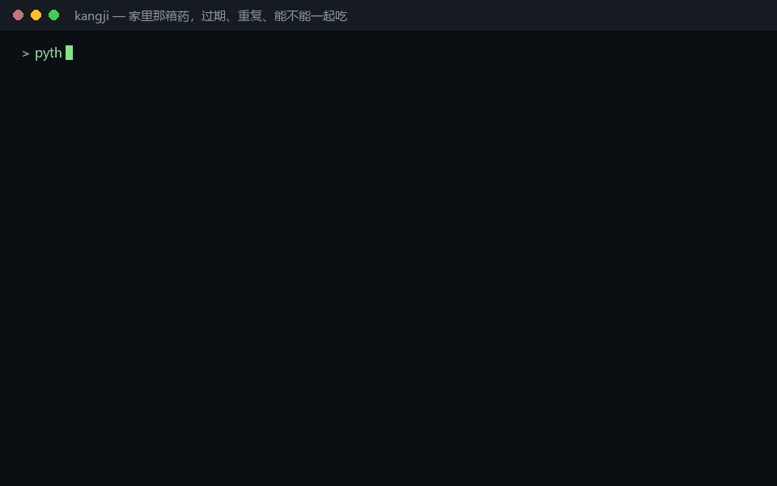
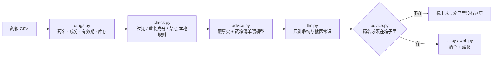

# Kangji · Home Medicine Cabinet Checker

[](https://github.com/wushiyi105-jpg/kangji/actions) []() [](./LICENSE) [](https://codecov.io/gh/wushiyi105-jpg/kangji)

That box of medicine at home always has a few things nobody can answer: is this expired, can these two be taken together, how many tablets are left from last time.

Kangji records the cabinet and handles it in two steps: **expiry, duplicated ingredients and forbidden combinations are hard facts, computed by local rules, the model never touches them**; **how to store things, which to deal with first, when not to handle it yourself — those go to the model**.

The model has one very annoying habit here: midway through it recommends a medicine that is not in your cabinet at all. So every drug name in the advice goes through a check — anything not on the list gets flagged.



## Why the split has to be this strict

With medicine, the cost of the model making something up is not "a poor answer" — it is somebody actually taking it.

And it makes things up very naturally: "just throw out the expired ones, and you can take ibuprofen alongside". You do not have ibuprofen; the sentence is not wrong in itself, but it has crossed from "management advice" into "medication recommendation".

So the split is fixed:

| Who | Does what | Why |
| --- | --- | --- |
| Local rules | Expiry days, duplicated ingredients, forbidden drug pairs, stock | There is a definite answer; compute it and it is right |
| Model | Which to clear first, how to store separately, when to see a doctor | No single answer; needs the situation strung together |

Two lists are hard-coded into the prompt — may say / may not say: no diagnosis, no "you have disease X", no dose, no course length, no recommending a new drug, no judging whether a drug "works well". When unsure, write "follow the leaflet" or "ask a pharmacist".

## What the drug library looks like

26 common drugs, four fields each: generic name, aliases, ingredients, tags.

```python
{"name": "复方感冒药", "aliases": ["999感冒灵", "白加黑", "新康泰克", "快克", "感康", "泰诺"],
 "ingredients": ["对乙酰氨基酚", "马来酸氯苯那敏", "人工牛黄"], "kind": "感冒",
 "tags": ["含对乙酰氨基酚", "嗜睡"]}
```

The "compound cold medicine" entry matters most. It has seven or eight brand names and they all contain paracetamol — which means **999感冒灵 + 泰诺林 is the same ingredient taken twice**. Without that entry, duplicate-ingredient detection is worthless.

Lookup goes through three levels: exact name → alias → contains. So "布洛芬缓释胶囊", "芬必得" and "布洛芬" all land on the same entry.

## What a conflict rule looks like

```python
{"a": ["头孢类", "甲硝唑"], "b_tags": ["含酒精"], "level": "high",
 "why": "头孢/甲硝唑遇上酒精可能引起双硫仑样反应：脸红、心悸、血压下降，严重会休克。"}
```

Rules match in two ways:

- by name pair (two NSAIDs together)
- by tag pair (cephalosporin + anything tagged "contains alcohol")

There is a third, `through_ingredient`: the pair "compound cold medicine + paracetamol-type" must not be reported on type alone — the ingredients on both sides have to actually overlap. Otherwise a cold medicine plus a fever reducer without paracetamol would be falsely flagged.

The same box appearing twice is not a conflict — that is double-counted stock, so `check` de-duplicates by generic name before pairing anything up.

## One real run

The sample `samples/药箱.csv` has ten entries, with today pinned to 2026-11-25:

```
检查于 2026-11-25 · 10 条 · 有硬问题，先处理 · 过期 1 个、60 天内到期 1 个、
重复成分 1 项、不宜同用 2 对、已经用完 1 个、认不出 1 个

过期了，别吃：
  · 氯雷他定 — 过期 15 天，2026-11-10

60 天内到期：
  · 999感冒灵 — 还剩 25 天，2026-12-20

同一成分出现在好几盒里（一起吃等于加量）：
  · 对乙酰氨基酚：999感冒灵、泰诺林

不宜同用：
  · [high] 头孢克肟 + 藿香正气水
    头孢/甲硝唑遇上酒精可能引起双硫仑样反应：脸红、心悸、血压下降，严重会休克。
  · [high] 999感冒灵 + 泰诺林
    复方感冒药里通常已经含对乙酰氨基酚，再单独吃退烧药等于同一成分加倍。（两边都有：对乙酰氨基酚）

已经用完了：
  · 维生素C 剩 0

库里没有，没参与检查：板蓝根颗粒
```

I planted that list on purpose: one box half a month expired, one nearly expiring, one duplicated ingredient, one forbidden pair, one empty box, one drug the library does not know. Every one caught.

Asking the model about the same cabinet produced this:

```
1. 清理过期的氯雷他定，并排查标记那 1 个 60 天内到期的药品。
2. 将 999感冒灵与泰诺林分开存放并标记，提醒两者不宜同用。
3. 标记头孢克肟与藿香正气水，提醒两者不宜同用。
4. 将外用的创可贴与内服药分开收纳，所有药品保留原包装并置于避光避潮处。
5. 若用药后症状未缓解或出现不确定的严重情况，别自己处理，直接去医院。
```

All five talk about "how to manage"; none about "what you should take". Verification result: **0 drug names outside the cabinet**.

## Things I got wrong

**One: the column cannot be called `foreign`.** Creating the table gave `near "TEXT": syntax error` — `FOREIGN` is an SQLite keyword, and `foreign TEXT NOT NULL` was parsed as the start of `FOREIGN KEY`. Renamed to `outsiders`, mapped back to `foreign` on read, so the layer above still calls it that.

**Two: "almost out" flagged seven entries.** The first threshold was `qty <= 2`, and seven of ten samples tripped it — most boxes at home hold one or two tablets anyway, so the threshold marked everything. A warning that fills the screen gets read by nobody. Changed to report only `qty <= 0` (genuinely empty) by default, with `--low-stock` as a parameter for anyone who wants it looser.

**Three: the model's numbering is not trustworthy.** Its `n` is sometimes missing, sometimes repeated, sometimes starting at 0. The first version printed it directly and produced "None. 清理过期药", "2. …", "1. …". Numbering is now re-sequenced by the program and hard-capped at five items — a cabinet adviser handing out ten suggestions is the same as handing out none.

**Four: drug-name verification.** `find_foreign_meds` scans the model output with every name and alias in the library: if it hits but the generic name is not in your cabinet, that is an "outside drug". The same one appearing in the body and the closing summary is reported once. Tests pin `test_catches_new_drug` ("可以配合布洛芬" must be caught) and `test_catches_brand_alias` ("芬必得" must be caught too).

## Data flow

How one piece of data moves between the modules:



## Quick start

```bash
git clone https://github.com/wushiyi105-jpg/kangji.git && cd kangji
cp .env.example .env      # fill in LLM_API_KEY

python -m kangji import samples/药箱.csv
python -m kangji check
python -m kangji advice          # only this step calls the model, tens of seconds
```

Start the Web UI:

```bash
python -m kangji serve           # http://127.0.0.1:8772
```

Run in Docker (the container uses the default port 8772):

```bash
docker build -t kangji .
docker run -p 8772:8772 kangji
```

## 🤔 Why not just ask a general LLM

A general model can say "do not take these together". Kangji adds the three things it cannot:

1. **Hard facts computed locally** — which box expired, whether two boxes share an ingredient, whether a contraindication exists, all come from local rules that are deterministic and reviewable. The model handles storage advice, what to deal with first, and when not to tough it out alone.
2. **Drug names must verify** — the model's worst habit is recommending something not in your box. Every drug name in its advice is checked against the inventory, and anything missing is flagged instead of sending you shopping.
3. **The medicine box stays home** — what you take, who takes it, how many pills remain, live in local SQLite. That is far more sensitive than spending records and is never uploaded.
4. **Hard facts work offline** — `check` is entirely local, still listing expired, duplicated and conflicting items; only the `advice` paragraph needs a model.

## 🎯 Use cases

- **Quarterly clean-out**: import the box and run `check` once — bin the expired first, then spot duplicates such as two cold medicines that both contain paracetamol, without reading every leaflet.
- **Before an elderly parent takes several medicines**: check contraindications first, then read when not to tough it out and to go to hospital, instead of guessing.
- **Deciding what to pack for a trip**: see which box expires soon and which has two pills left, and take only those.

## 🗺 Roadmap

- **Better interaction data**: source and population for each contraindication rule, with "limited evidence" stated where true.
- **Photograph a box to add it**: fill name and specification from one photo, reducing typing errors.
- **Dose reminders**: daily reminders by frequency, with a record of whether today's dose was taken.
- **Per-person boxes**: separate boxes for family members so an elder's medicine never lands in a child's list.
- **Expiry nudges**: warn at 30 and 7 days before expiry, not when it is already time to bin it.

## ❓ FAQ

**Where do I get an API key?**
The project ships without one. It defaults to Zhipu (`glm-4.6`); DeepSeek or a local model also work. Only `advice` uses it — `check` does not.

**Where is data stored, and is it uploaded?**
The inventory and check records sit in local SQLite (default `data/kangji.db`); a model call sends drug names and rule hits, not the personal medication history in the box.

**Does it work without a key?**
Yes. `check` is fully local: expiry, duplicate ingredients and contraindications still evaluate. Only the `advice` paragraph is missing.

**How do I switch models?**
Change `LLM_BASE_URL`, `LLM_MODEL` and `LLM_API_KEY`; local rules are unaffected.

**Can it replace a doctor?**
No, and it does not try. It lays out the facts in your box and tells you when to seek care; diagnosis and prescriptions are out of scope.

## Commands

| Command | What it does |
| --- | --- |
| `add <药名> --qty --expire --place --note` | Record a box. Same name and same expiry counts as one batch, quantities add up |
| `import <csv>` | Bulk import; headers accept `名称/数量/有效期/位置/备注` and the English equivalents |
| `list` | The cabinet list |
| `check [--today] [--low-stock] [--json] [--out]` | Run the check; `--today` moves "today" to any date |
| `advice [--today] [--json]` | Hand the check result to the model for management advice |
| `use <id> --n` | Use a few up; entries are never deleted automatically |
| `show <id>` / `rm <id>` / `stats` / `serve` | Detail / delete / stats / start the Web UI |

`--today` is the flag I use most: checking my parents' cabinet does not have to wait until something is actually expired to learn which box is about to be.

## The Web UI

Add medicine on the left; on the right, two buttons — check results and advice. The check is purely local, one click; "ask for advice" takes tens of seconds, so the button disables itself and says the model is writing.

Conflicts are coloured by level: red is a hard problem (disulfiram reaction, duplicated ingredient), yellow needs attention (expiring soon), green looks fine.

## Design trade-offs

- **Zero third-party dependencies**, Python 3.10+ standard library. Something you open twice a year should not need an environment set up to be usable.
- **Unknown drugs are not guessed.** If the library has no "板蓝根颗粒", the output says so plainly and excludes it from the check, rather than fuzzy-matching some ingredient onto it. 26 entries cannot cover every household cabinet, and that boundary has to be visible in the UI.
- **Reaching zero does not auto-delete.** "Used up" and "this box should not exist" are different things; you decide.
- **Advice is stored.** Every question leaves a record, so two months later you can look back at "what it told me to clear first", which beats memory.
- **A model failure does not affect the check.** If the endpoint is down, the check still comes out and the advice step says "the model gave no advice: unreachable". The core function of cabinet management should not be held hostage by an external API.

## Tests

```bash
python -m unittest discover -s tests
```

96 cases, all offline. Model calls are replaced by doubles, the Web layer starts a real server on `port=0`.

Covered: three-level drug-name matching (including dosage forms like "布洛芬缓释胶囊"), five date formats, duplicated ingredients only reported when two distinct drugs share them, both NSAID conflicts, cephalosporin + alcohol must be high, the same box recorded twice is not a conflict, the low-stock threshold, model numbering re-sequencing, outside-drug verification, SQLite same-batch merging vs separate batches, and the `foreign` column mapping.

`samples/药箱.csv` is asserted too (`test_sample_loads_and_checks`): the sample file is part of the documentation, and if it silently breaks one day the tests should know.

## Configuration

`.env` (already in `.gitignore`):

```
LLM_API_KEY=...
LLM_BASE_URL=https://open.bigmodel.cn/api/paas/v4
LLM_MODEL=glm-4.6
```

Works with any OpenAI-style `/chat/completions` endpoint. `--api-key --base-url --model` override it for one run.

## One thing that needs saying

This is not a medical tool. It does not know your condition and should not decide what you take. What it can do is compute the definite things about your cabinet — which box expired, which two share an ingredient, which pair should not sit together — and then remind you. When it really matters, go to a doctor or a pharmacist.

---

Author: shiyi
Email: wushiyi105@gmail.com
GitHub: [wushiyi105-jpg](https://github.com/wushiyi105-jpg)
