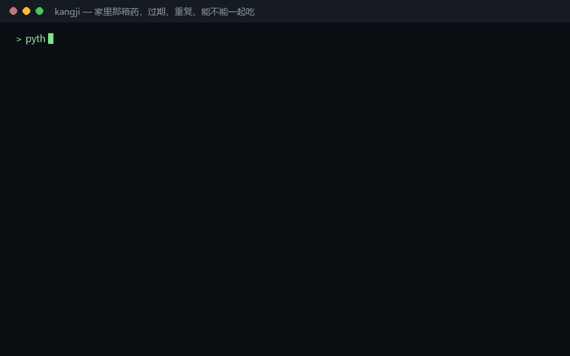

# 康记 kangji

家里那箱药，翻出来总有几个说不清的：这盒过期没有、这两盒能不能一起吃、上次买的还剩几片。

康记把药箱记下来，然后分两步处理：**过期、重复成分、禁忌组合这些硬事实，本地规则算，不碰模型**；**怎么收纳、先处理哪个、什么情况别自己扛，才交给模型讲**。

模型在这件事上有个很讨厌的毛病：说着说着给你推荐一个箱子里根本没有的药。所以每一条建议里的药名都要过一道核验，不是清单里的，标出来。



## 为什么非要这么分工

药这件事，模型编错的代价不是「答得不好」，是有人真的照着吃。

而且它编得特别自然：「过期药扔掉就行，另外可以配合布洛芬一起吃」。布洛芬你箱子里没有，这句话本身没错，但它越过了「管理建议」的边界，变成了用药推荐。

所以分工是死的：

| 谁做 | 做什么 | 为什么 |
| --- | --- | --- |
| 本地规则 | 过期天数、重复成分、禁忌药对、库存 | 有确定答案，算出来就是对的 |
| 模型 | 先清哪个、怎么分开放、什么时候去医院 | 没有唯一答案，需要把情况串起来说 |

提示词里能说/不能说两张清单是写死的：不诊断、不说「你这是xx病」、不给剂量不给疗程、不推荐新增药、不评价某个药「效果好/不好」。拿不准就写「按说明书」或「问药师」。

## 药库长什么样

26 条常见药，每条四个字段：通用名、别名、成分、标记。

```python
{"name": "复方感冒药", "aliases": ["999感冒灵", "白加黑", "新康泰克", "快克", "感康", "泰诺"],
 "ingredients": ["对乙酰氨基酚", "马来酸氯苯那敏", "人工牛黄"], "kind": "感冒",
 "tags": ["含对乙酰氨基酚", "嗜睡"]}
```

最关键的是「复方感冒药」这一条。它的商品名有七八个，成分里都有对乙酰氨基酚——也就是说，**999感冒灵 + 泰诺林，是同一个成分吃两遍**。这一条不建进去，重复成分检测等于白做。

查药走三级匹配：完全同名 → 别名 → 包含。所以「布洛芬缓释胶囊」「芬必得」「布洛芬」都落到同一条。

## 冲突规则的结构

```python
{"a": ["头孢类", "甲硝唑"], "b_tags": ["含酒精"], "level": "high",
 "why": "头孢/甲硝唑遇上酒精可能引起双硫仑样反应：脸红、心悸、血压下降，严重会休克。"}
```

规则有两种匹配方式：

- 按名字对（两种非甾体抗炎药同用）
- 按标记对（头孢 + 任何带「含酒精」标记的药）

还有第三种，`through_ingredient`：「复方感冒药 + 对乙酰氨基酚类」这对，不能光看类型就报，必须两边成分真的重叠才算。否则感冒药配一个不含对乙酰氨基酚的退烧药也会被误报。

同一盒药出现两次不算冲突——那是库存记重了，`check` 里先按通用名去重再两两比对。

## 一次真实跑出来的结果

样例 `samples/药箱.csv` 十条，把今天定在 2026-11-25：

```
检查于 2026-11-25 · 10 条 · 有硬问题，先处理 · 过期 1 个、60 天内到期 1 个、
重复成分 1 项、不宜同用 2 对、已经用完 1 个、认不出 1 个

过期了，别吃：
  · 氯雷他定 — 过期 15 天，2026-11-10

60 天内到期：
  · 999感冒灵 — 还剩 25 天，2026-12-20

同一成分出现在好几盒里（一起吃等于加量）：
  · 对乙酰氨基酚：999感冒灵、泰诺林

不宜同用：
  · [high] 头孢克肟 + 藿香正气水
    头孢/甲硝唑遇上酒精可能引起双硫仑样反应：脸红、心悸、血压下降，严重会休克。
  · [high] 999感冒灵 + 泰诺林
    复方感冒药里通常已经含对乙酰氨基酚，再单独吃退烧药等于同一成分加倍。（两边都有：对乙酰氨基酚）

已经用完了：
  · 维生素C 剩 0

库里没有，没参与检查：板蓝根颗粒
```

这份清单是我故意摆的：一盒过期半个月、一盒快到期、一对同成分、一对禁忌、一盒吃空了、一盒药库不认识。检查全中。

同一份药箱问模型，它给的建议是这样的：

```
1. 清理过期的氯雷他定，并排查标记那 1 个 60 天内到期的药品。
2. 将 999感冒灵与泰诺林分开存放并标记，提醒两者不宜同用。
3. 标记头孢克肟与藿香正气水，提醒两者不宜同用。
4. 将外用的创可贴与内服药分开收纳，所有药品保留原包装并置于避光避潮处。
5. 若用药后症状未缓解或出现不确定的严重情况，别自己处理，直接去医院。
```

五条都在讲「怎么管」，没有一条在讲「你该吃什么」。核验结果：**提到的箱外药名 0 处**。

## 踩到的坑

**一、列名不能叫 `foreign`。** 建表时直接 `near "TEXT": syntax error`——`FOREIGN` 是 SQLite 的保留字，`foreign TEXT NOT NULL` 被当成 `FOREIGN KEY` 的开头去解析了。改成 `outsiders`，读出来再映射回 `foreign`，代码里那一层对外仍然叫这个名。

**二、「快用完了」报了七条。** 第一版阈值定在 `qty <= 2`，样例十条里七条中招——家里每盒药本来大多就剩一两片，这个阈值等于把所有药都标一遍。警告一旦铺满屏幕就没人看了。改成默认只报 `qty <= 0`（真的没了），阈值留成 `--low-stock` 参数，想放宽自己放宽。

**三、模型的编号靠不住。** 它给的 `n` 有时缺、有时重复、有时从 0 开始。第一版直接拿来打印，出来是「None. 清理过期药」「2. …」「1. …」。现在编号一律由程序重排，并硬性只保留前五条——给十条建议的药箱顾问，等于没给建议。

**四、药名核验。** `find_foreign_meds` 把整张药库的名字和别名拿去扫模型输出：命中了、但通用名不在你的药箱里，就算「箱外药」。同一条在建议正文和结尾小结里各出现一次，只提示一次。测试里钉着 `test_catches_new_drug`（「可以配合布洛芬」必须被抓）和 `test_catches_brand_alias`（「芬必得」也要被抓）。

## 快速开始

```bash
git clone https://github.com/wushiyi105-jpg/kangji.git && cd kangji
cp .env.example .env      # 填 LLM_API_KEY

python -m kangji import samples/药箱.csv
python -m kangji check
python -m kangji advice          # 这一步才调模型，十几秒
```

起网页：

```bash
python -m kangji serve           # http://127.0.0.1:8772
```

## 命令

| 命令 | 做什么 |
| --- | --- |
| `add <药名> --qty --expire --place --note` | 记一盒。同名同有效期视为同一批次，数量叠加 |
| `import <csv>` | 批量导入，表头认 `名称/数量/有效期/位置/备注`，也认英文 |
| `list` | 药箱清单 |
| `check [--today] [--low-stock] [--json] [--out]` | 跑一遍检查，`--today` 可以把「今天」拨到任意日期 |
| `advice [--today] [--json]` | 把检查结果给模型，要管理建议 |
| `use <id> --n` | 用掉几个，不会自动删条目 |
| `show <id>` / `rm <id>` / `stats` / `serve` | 详情 / 删除 / 统计 / 起网页 |

`--today` 是我自己用着最顺的一个参数：给爸妈的药箱做检查，不用等到真过期那天才知道哪盒要到期。

## 网页

左边加药，右边检查结果和建议两个按钮。检查纯本地，点一下就出；「问管理建议」要等十几秒，按钮会禁用并提示模型在写。

界面把冲突按等级上色：红色是硬问题（双硫仑、成分重复），黄色是要留意（临期），绿色是看着还行。

## 设计取舍

- **零第三方依赖**，Python 3.10+ 标准库。药箱这种一年翻两次的东西，不该需要装环境才能用。
- **认不出的药不猜**。药库里没有「板蓝根颗粒」，就老实列出来说没参与检查，而不是拿模糊匹配硬套一个成分上去。26 条药库覆盖不了所有家庭药箱，这条边界必须写在界面上。
- **到 0 不自动删**。用完了和「这盒不该存在」是两回事，删不删你自己定。
- **建议存库**。每次问完留一条记录，过两个月回头看「当时它让我先清哪个」，比记忆可靠。
- **模型失败不影响检查**。接口挂了，检查结果照出，建议那一步显示「模型没给建议：连不上」。药箱管理的核心功能不该被一个外部接口拖住。

## 测试

```bash
python -m unittest discover -s tests
```

96 个用例，全离线。模型调用全用替身接管，Web 用 `port=0` 起真服务再打。

覆盖：三级药名匹配（含「布洛芬缓释胶囊」这类带剂型的写法）、五种日期格式、重复成分必须两个不同药才报、两种非甾体的冲突、头孢+酒精必须 high、同一盒药记两次不算冲突、低库存阈值、模型编号重排、箱外药名核验、SQLite 同批次合并与不同批次分开、`foreign` 列映射。

`samples/药箱.csv` 本身也有断言（`test_sample_loads_and_checks`）：样例文件是文档的一部分，它哪天悄悄坏掉，测试得知道。

## 配置

`.env`（已在 `.gitignore` 里）：

```
LLM_API_KEY=...
LLM_BASE_URL=https://open.bigmodel.cn/api/paas/v4
LLM_MODEL=glm-4.6
```

兼容任何 OpenAI 风格 `/chat/completions` 接口。命令行 `--api-key --base-url --model` 可临时覆盖。

## 一句该说清楚的

这不是医疗工具。它不认识你的病，也不该替你决定吃什么药。它能做的是把药箱里那些确定的事算清楚——哪盒过期了、哪两盒成分撞了、哪一对不该放一起——然后提醒你，真正拿不准的时候去找医生或药师。

---

作者：shiyi
邮箱：wushiyi105@gmail.com
GitHub：[wushiyi105-jpg](https://github.com/wushiyi105-jpg)
